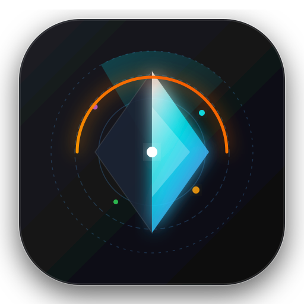

<p align="center">
  
</p>

<h1 align="center">Vesper</h1>

<p align="center">
  <strong>Native macOS Storage Inspector & Deep Cleaner</strong><br>
  <em>Giải mã triệt để "Documents 60GB" & "System Data" bị phình to trên macOS</em>
</p>

<p align="center">
  <a href="https://damducduyit.github.io/vesper/"></a>
  
  
  
  
</p>

---

## 🔍 Tại sao bạn cần Vesper?

Nếu bạn dùng Mac (đặc biệt là bản 256GB / 512GB), bạn chắc chắn từng gặp hiện tượng:
1. **Mục Documents báo 60GB–100GB**, nhưng khi click vào:
   - **Large Files** trống trơn không có gì.
   - **File Browser** chỉ hiển thị các file vài KB hoặc vài MB.
2. **System Data chiếm từ 50GB–90GB** mà không rõ app nào đang ngốn ổ đĩa.

### Nguyên nhân kỹ thuật:
- **Thư mục ẩn (`~/.*`)**: Toàn bộ thư mục bắt đầu bằng dấu chấm (`~/.cache`, `~/.npm`, `~/.gradle`, `~/.cargo`, `~/.bun`, `~/.local`, `~/.gemini`, `~/.vscode`, `~/.ollama`...) nằm trong thư mục Home được macOS cộng dồn vào danh mục **Documents**, nhưng trình File Browser mặc định lại **ẩn toàn bộ file có dấu chấm**.
- **Hàng trăm nghìn file nhỏ (`node_modules`, `.venv`, `target`)**: Tab *Large Files* chỉ quét các file đơn lẻ > 50MB. Một thư mục `node_modules` chứa 150.000 file nhỏ 10KB chiếm 15GB sẽ **hoàn toàn vô hình** trên trình quản lý của macOS.
- **`~/Library` không được phân loại rõ ràng**: Cache của trình duyệt, simulator của Xcode (`DerivedData`), app containers phình to mà không có cảnh báo.

**Vesper** ra đời để giải quyết tận gốc vấn đề này với hiệu năng bản địa và tính thẩm mỹ cao nhất.

---

## ✨ Tính năng nổi bật

- 🔭 **Quét Thông Minh (Smart Scan) 4 Pha:**
  - **Pha 1 (`~/.*`):** Vạch trần toàn bộ thư mục ẩn trong `$HOME` chiếm dung lượng $\ge$ 5MB.
  - **Pha 2 (`~/Library`):** Bóc tách `Caches`, `Logs`, `Application Support`, `Containers`, `Xcode DerivedData`.
  - **Pha 3 (`Code & Build Artifacts`):** Tìm mọi `node_modules`, `.venv`, `venv`, `target`, `.next`, `Pods`... bằng cơ chế prune đa luồng siêu tốc.
  - **Pha 4 (`File đơn lẻ lớn`):** Quét xuyên qua cả thư mục ẩn và thư mục hệ thống.
- 🗺️ **Bản đồ tỷ lệ dung lượng Treemap:**
  - Trực quan hóa dung lượng theo diện tích.
  - Phân loại màu sắc thông minh:
    - 🟢 **Emerald:** Cache / Build tạm an toàn để xóa ngay.
    - 🟣 **Violet:** Thư mục ẩn trong Home (`~/.*`).
    - 🔵 **Cyan:** Thư viện mã nguồn (`node_modules`).
    - 🟡 **Amber:** Cần cân nhắc.
    - 🔴 **Crimson:** File cá nhân / Dữ liệu app.
- 🗂️ **Trình duyệt cây thư mục (Disk Explorer):**
  - Hiển thị 100% file ẩn và thư mục ẩn với dung lượng vật lý thực tế trên APFS (`du -skx`).
  - Hỗ trợ Breadcrumb navigation, phím tắt điều hướng `↑` / `↓` / `Enter`.
- 🛡️ **Thanh Inspector & Xóa An Toàn:**
  - Cung cấp đánh giá mức độ rủi ro trước khi xóa.
  - Hỗ trợ **Đưa vào Thùng rác (Move to Trash)** hoặc **Xóa vĩnh viễn (Permanent Delete)** để giải phóng dung lượng ngay tức khắc.
  - 1-click **Mở trong Finder** hoặc **Mở Terminal tại thư mục**.

---

## 🖥️ Giao diện 3-Column macOS Native

Thiết kế theo chuẩn **macOS Human Interface Guidelines (HIG)**:
- Cột **Sidebar** kính mờ (`NSVisualEffectView` Vibrancy) tích hợp đèn giao thông `hiddenInset`.
- Cột **Main Workspace** mật độ cao (`NSTableView` 32px/hàng, số liệu `tabular-nums` chống giật).
- Cột **Inspector (`⌘I`)** hiển thị nguồn gốc, ý nghĩa của thư mục và thao tác nhanh.

---

## 🚀 Cài đặt & Khởi chạy

### Yêu cầu hệ thống:
- macOS 11.0 (Big Sur) trở lên (Tương thích cả Apple Silicon M1/M2/M3/M4 và Intel).
- Node.js 18+.

### Chạy từ mã nguồn:
```bash
# Clone repository
git clone https://github.com/DamDucDuyIT/vesper.git
cd vesper

# Cài đặt dependencies (chỉ chứa electron)
npm install

# Khởi chạy ứng dụng
npm start
```

---

## 📦 Phát hành (Releases)

Các bản dựng đóng gói sẵn dạng `.dmg` hoặc `.zip` có thể tải trực tiếp từ mục [Releases](https://github.com/DamDucDuyIT/vesper/releases).

---

## ⚖️ Giấy phép

Phát hành dưới giấy phép [MIT License](LICENSE). Bản quyền thuộc về [DamDucDuyIT](https://github.com/DamDucDuyIT).
